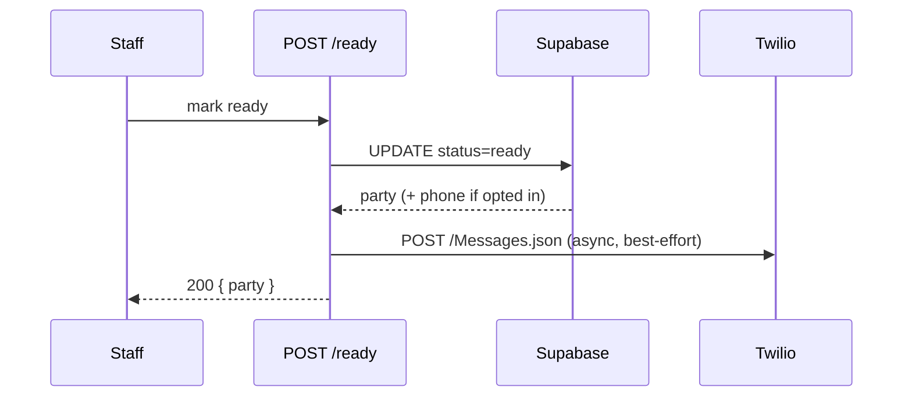

# Research: FR-014 SMS on table ready

**Date**: 2026-06-25T13:46:12Z  
**Researcher**: Auto  
**Git Commit**: `c0acf11806857c7110deb7e11c6460cabeedeba2`  
**Branch**: main  
**Repository**: [customcodepl/notqueue](https://github.com/customcodepl/notqueue)

## Research Question

What is required to implement **FR-014** — guest receives an SMS notification when their table is ready — in the current NotQueue codebase?

## Summary

FR-014 is a **nice-to-have** parked for MVP v1. The primary table-ready loop is already satisfied by **FR-013** (guest status page via 30s polling). **No SMS infrastructure exists today**: no phone fields in schema, no notification service, no send hook on mark-ready.

Implementing FR-014 is a **vertical v2 slice** requiring:

1. **Schema** — `phone_e164`, `sms_opt_in`, consent timestamp, optional `ready_sms_sent_at` on `parties` (or separate PII table).
2. **UI** — staff and/or guest capture of phone + explicit opt-in.
3. **Send path** — recommended: **Twilio REST `fetch` from `POST /api/parties/[partyId]/ready`** after `markPartyReady()` succeeds (fire-and-forget; do not fail ready on SMS error).
4. **Secrets** — extend `astro.config.mjs` env schema + Wrangler secrets (`TWILIO_*`), same pattern as `SUPABASE_URL` / `SUPABASE_KEY`.

**Reject** Supabase Auth SMS — it is OTP-only for auth, not transactional messaging to tokenized guests.

**Locked decisions (2026-06-25):** guest opt-in on status page; SMS only on explicit Ready; Poland/EU (`+48` default).

Estimated complexity: **low–medium** (one migration, one service module, guest UI + RPC, env wiring). Cost: ~€0.01–0.05/SMS (Twilio EU).

## Detailed Findings

### Product context (FR-014)

FR-014 is explicitly secondary to the guest status page:

- [PRD Success Criteria](https://github.com/customcodepl/notqueue/blob/c0acf11/context/foundation/prd.md#L47): SMS is "nice-to-have; not required for the primary loop."
- [PRD FR-014](https://github.com/customcodepl/notqueue/blob/c0acf11/context/foundation/prd.md#L105): must-have table-ready UX is FR-013 on the guest page.
- [Roadmap Parked](https://github.com/customcodepl/notqueue/blob/c0acf11/context/foundation/roadmap.md#L158): parked for speed; outside primary success loop.

MVP v1 delivered table-ready via **polling** (`useGuestPartyView`), not push/SMS. See [lessons.md — Guest live updates](https://github.com/customcodepl/notqueue/blob/c0acf11/context/foundation/lessons.md#L10-L13).

### Current mark-ready flow

Staff taps **Ready** → `POST /api/parties/{partyId}/ready` → `markPartyReady()`:

1. [ready.ts](https://github.com/customcodepl/notqueue/blob/c0acf11/src/pages/api/parties/%5BpartyId%5D/ready.ts#L22-L25) — staff auth, calls service, returns `{ party }`.
2. [parties.ts `markPartyReady`](https://github.com/customcodepl/notqueue/blob/c0acf11/src/lib/services/parties.ts#L214-L239) — guards `status === 'waiting'`, sets `status: 'ready'`, `position: null`, repacks waiting queue.
3. [QueueDashboard.tsx](https://github.com/customcodepl/notqueue/blob/c0acf11/src/components/queue/QueueDashboard.tsx) — staff UI triggers hook.
4. [useGuestPartyView.ts](https://github.com/customcodepl/notqueue/blob/c0acf11/src/components/hooks/useGuestPartyView.ts) — guest polls `get_guest_party_view` (~30s); [GuestStatus.tsx](https://github.com/customcodepl/notqueue/blob/c0acf11/src/components/guest/GuestStatus.tsx) renders ready state.

**No post-ready hook** exists — no webhooks, Edge Functions, or notification side effects.

Status transitions:

```
waiting --markPartyReady--> ready --seatParty--> seated
waiting --advanceQueue----> seated  (skips ready; SMS would not fire on this path unless also handled)
```

### Data model gaps

Current `parties` table ([migration](https://github.com/customcodepl/notqueue/blob/c0acf11/supabase/migrations/20260609120000_queue_schema.sql#L19-L28)):

| Column | Present |
|--------|---------|
| `display_name`, `party_size` | yes |
| `phone_e164` / mobile | **no** |
| `sms_opt_in` | **no** |
| `ready_sms_sent_at` | **no** |

[CreatePartyInput](https://github.com/customcodepl/notqueue/blob/c0acf11/src/types.ts) and [add-party form](https://github.com/customcodepl/notqueue/blob/c0acf11/src/components/queue/QueueDashboard.tsx) collect only name + size.

Guest RPC [get_guest_party_view](https://github.com/customcodepl/notqueue/blob/c0acf11/supabase/migrations/20260609120100_queue_rls.sql#L166-L174) returns no phone — **must stay that way** for privacy (PRD NFR).

Venue seed `info_text` says "we will notify you" but is static copy only ([seed.sql](https://github.com/customcodepl/notqueue/blob/c0acf11/supabase/seed.sql)).

### SMS integration options

| Approach | Verdict | Rationale |
|----------|---------|-----------|
| **Twilio from Worker API route** | **Recommended** | Matches Astro SSR + Cloudflare Workers; secrets via `astro:env/server`; hook at `ready.ts` after DB success |
| Supabase Auth SMS | **Reject** | OTP/auth only (`[auth.sms]` in [config.toml](https://github.com/customcodepl/notqueue/blob/c0acf11/supabase/config.toml#L240-L277)); guests have no auth account |
| Supabase Edge Function | Defer | No `supabase/functions/` in repo; adds second deploy surface |
| DB trigger + webhook | Defer | Only `ready.ts` writes `ready` today; extra complexity for idempotency/auth |

[infrastructure.md](https://github.com/customcodepl/notqueue/blob/c0acf11/context/foundation/infrastructure.md#L70) already notes SMS = outbound fetch + provider secrets on Workers — compatible with current stack.

**Env pattern to extend** ([astro.config.mjs](https://github.com/customcodepl/notqueue/blob/c0acf11/astro.config.mjs#L17-L23)):

```
TWILIO_ACCOUNT_SID, TWILIO_AUTH_TOKEN, TWILIO_MESSAGING_SERVICE_SID (or TWILIO_FROM_NUMBER)
SMS_ENABLED (optional dev toggle)
```

Local: `.dev.vars`. Prod: `wrangler secret put`. Do **not** reuse `SUPABASE_AUTH_SMS_TWILIO_AUTH_TOKEN`.

### Recommended implementation shape



**Send rules:**

- Send only if `sms_opt_in && phone_e164 IS NOT NULL && ready_sms_sent_at IS NULL`
- Do not fail mark-ready if SMS fails (log + optional `sms_notifications` audit row)
- Record `ready_sms_sent_at` or Twilio SID for idempotency
- Message: venue name + "your table is ready" + optional guest URL from `guest_tokens.token`

### RLS implications

- Staff write: existing `staff_insert_parties` / `staff_update_parties` covers new columns.
- Guest opt-in: requires new RPC (pattern: `issue_guest_token`, `get_guest_party_view`) — **no broad anon UPDATE**.
- Phone must **not** appear in `get_guest_party_view` JSON.
- SMS audit log: service-role / staff SELECT only.

## Code References

- [`src/pages/api/parties/[partyId]/ready.ts`](https://github.com/customcodepl/notqueue/blob/c0acf11/src/pages/api/parties/%5BpartyId%5D/ready.ts) — primary SMS hook point
- [`src/lib/services/parties.ts:214-239`](https://github.com/customcodepl/notqueue/blob/c0acf11/src/lib/services/parties.ts#L214-L239) — `markPartyReady` mutation
- [`supabase/migrations/20260609120000_queue_schema.sql`](https://github.com/customcodepl/notqueue/blob/c0acf11/supabase/migrations/20260609120000_queue_schema.sql) — parties schema (no phone)
- [`src/components/hooks/useGuestPartyView.ts`](https://github.com/customcodepl/notqueue/blob/c0acf11/src/components/hooks/useGuestPartyView.ts) — guest polling (FR-013 delivery)
- [`astro.config.mjs`](https://github.com/customcodepl/notqueue/blob/c0acf11/astro.config.mjs) — env schema to extend
- [`supabase/config.toml`](https://github.com/customcodepl/notqueue/blob/c0acf11/supabase/config.toml#L240-L277) — Auth SMS stubs (not for FR-014)

## Architecture Insights

- **Single write path for ready:** `markPartyReady` is the natural choke point; `advanceQueue` bypasses `ready` — decide whether SMS applies only to explicit Ready or also Call-next.
- **Complements, not replaces polling:** SMS helps guests who left the status page open in background or walked away; polling still satisfies FR-013.
- **Privacy boundary holds:** phone is staff/service-only; guest token RPC stays unchanged.
- **Failure isolation:** SMS is ancillary (nice-to-have); ready mutation must remain reliable under provider outage.

## Historical Context (from prior changes)

- Every MVP slice excluded SMS in plan out-of-scope: F-01, S-01–S-05 archives.
- [S-05 plan-brief](https://github.com/customcodepl/notqueue/blob/c0acf11/context/archive/2026-06-12-guest-live-wait-status/plan-brief.md): "Out of scope: … SMS (FR-014)."
- [S-05 impl-review](https://github.com/customcodepl/notqueue/blob/c0acf11/context/archive/2026-06-12-guest-live-wait-status/reviews/impl-review.md): SMS not introduced — scope discipline pass.
- [S-03 plan](https://github.com/customcodepl/notqueue/blob/c0acf11/context/archive/2026-06-10-staff-advance-and-ready-queue/plan.md): mutations visible to guests via RPC; no notification channel.
- [bootstrap verification](https://github.com/customcodepl/notqueue/blob/c0acf11/context/archive/2026-05-30-bootstrap-verification/verification.md): "SMS notifications (FR-014, nice-to-have) remain a downstream add-on."

## Research Decisions (locked 2026-06-25)

User-aligned scope for `/10x-plan`:

| Decision | Choice | Implication |
|----------|--------|-------------|
| Phone + opt-in | **Guest on status page** | New UI on `GuestStatus`; no phone field on staff add-party form |
| Send trigger | **Ready only** | Hook stays in `ready.ts` / `markPartyReady` path; `advanceQueue` unchanged |
| Market | **Poland / EU** | E.164 validation; UI default prefix `+48`; Twilio EU-capable sender |
| Provider | **Twilio** (default) | Worker `fetch` to Messages API; secrets in `astro:env/server` |
| Privacy | Phone never in guest RPC | `get_guest_party_view` unchanged; separate opt-in RPC returns success only |
| Failure mode | Best-effort SMS | Mark-ready succeeds even if Twilio fails; log + `ready_sms_sent_at` guard |

### Guest opt-in — concrete shape

Guests are tokenized (`/guest/[token].astro` → `get_guest_party_view`). Anon cannot `UPDATE parties` ([RLS](https://github.com/customcodepl/notqueue/blob/c0acf11/supabase/migrations/20260609120100_queue_rls.sql#L118-L129)).

Follow existing `set_guest_context` / `SECURITY DEFINER` pattern ([queue_rls.sql:131-153](https://github.com/customcodepl/notqueue/blob/c0acf11/supabase/migrations/20260609120100_queue_rls.sql#L131-L153)):

1. Migration: `parties.phone_e164`, `parties.sms_opt_in`, `parties.sms_opt_in_at`, `parties.ready_sms_sent_at`
2. New RPC `set_guest_sms_opt_in(p_token, p_phone_e164, p_opt_in)` — validates token, normalizes E.164 (`+48…`), sets columns; returns `{ ok: true }` only (no phone in response)
3. Guest UI: optional collapsible “Get SMS when ready” — phone input (default `+48`), checkbox consent, save once (disable after opt-in)
4. Optional: `GET` slice on guest RPC returning `{ sms_opt_in: boolean }` without phone — or infer from party row server-side at send time only

Send at ready ([ready.ts](https://github.com/customcodepl/notqueue/blob/c0acf11/src/pages/api/parties/%5BpartyId%5D/ready.ts)):

```
markPartyReady() → load party + phone if sms_opt_in → sendTableReadySms() → return party
```

Message template (PL): *„{display_name}, Twój stolik w {venue} jest gotowy!”* + optional guest URL.

## Related Research

(none — first research artifact for this change)

## Open Questions

1. **Roadmap unpark** — add `S-06` to `roadmap.md` when planning starts, or keep as standalone change? (Defer to `/10x-plan`.)
2. **Twilio sender** — Messaging Service vs single `+48` number; depends on Twilio account setup at implement time.

## Suggested next step

Run `/10x-plan sms-table-ready` — research is complete; decisions above are inputs to the plan.
